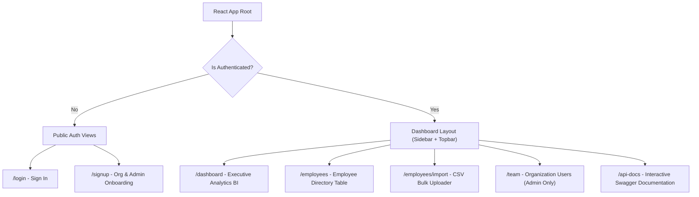

# Frontend React Application Architecture & Implementation Plan
## Employee Salary Management System (ACME Corp & Multi-Tenant SaaS)

---

## 1. Executive Summary & Objective

This document outlines the frontend architecture for the **Employee Salary Management System**, designed to connect directly with the existing Ruby on Rails 8 API backend. The React Single Page Application (SPA) empowers **HR Managers** and **Organization Admins** to oversee global compensation datasets (10,000+ benchmark employees), explore real-time visual analytics, filter paginated data grids, import bulk CSV files, and manage team member access.

---

## 2. Tech Stack & Architectural Decisions

| Layer | Technology | Rationale |
| :--- | :--- | :--- |
| **Framework & Build** | **React + Vite** | Instant server startup (< 200ms), lightning-fast Hot Module Replacement (HMR), optimized production bundling with Rollup. |
| **Routing** | **React Router v6** | Declarative client-side routing, protected route wrappers, automatic auth redirection. |
| **State Management** | **React Context / Zustand** | Lightweight, predictable state management for auth tokens, active user profile, and filters without Redux boilerplate. |
| **API Client** | **Axios with Interceptors** | Automatic `Authorization: Bearer <token>` injection, unified error handling, and 401 session expiration handling. |
| **Data Visualization** | **Recharts** | Declarative SVG charts: horizontal bar charts for country salary parity and donut charts for department budget share. |
| **Styling & Design System** | **Modern Vanilla CSS & CSS Variables** | Bespoke design system tokens (palette, spacing, glassmorphism, responsive tables, dark/light themes). |
| **Icons** | **Lucide React** | Clean, modern, lightweight icon library. |

---

## 3. Application Route Map



---

## 4. Module Breakdown & Backend API Integration

### **Module 1: Authentication & Organization Onboarding**
- **Views**:
  - `SignInPage`: Email and password login.
  - `SignUpPage`: Two-step onboarding:
    1. **Live Org Name Availability Checker**: Debounced query against `GET /api/v1/organizations/validate?name=...` displaying live badge status (Available / Already Registered).
    2. **Admin Account Creation**: Submits `POST /api/v1/sign_up` with `{ organization_name, email, password, password_confirmation }`.
- **State & Storage**:
  - Persist signed session token in `localStorage`.
  - Axios HTTP Interceptor automatically injects `Authorization: Bearer <token>`.
  - On `401 Unauthorized`, automatically clear stored credentials and route to `/login`.
- **Mapped Backend Endpoints**:
  - `POST /api/v1/sign_in`
  - `DELETE /api/v1/sign_out`
  - `POST /api/v1/sign_up`
  - `GET /api/v1/me`
  - `GET /api/v1/organizations/validate`

---

### **Module 2: Executive BI Dashboard (`/dashboard`)**
- **Components**:
  - `MetricCardGrid`: High-level executive KPI summary cards:
    - **Total Company Annual Payroll** (formatted currency, e.g., `$1,120,450,000.00`)
    - **Average Annual Salary** (e.g., `$112,045.00`)
    - **Total Employee Count** (e.g., `10,000`)
  - `CountryPayrollBarChart`: Horizontal bar chart ranking countries by total payroll commitment and workforce headcount.
  - `DepartmentBudgetDonutChart`: Interactive donut chart illustrating salary budget allocation percentages per department.
  - `DepartmentComparisonTable`: Tabular breakdown comparing departmental headcount and average salary.
- **Mapped Backend Endpoints**:
  - `GET /api/v1/analytics`

---

### **Module 3: Employee Directory & Compensation Data Grid (`/employees`)**
- **Components**:
  - `FilterToolbar`:
    - Dropdowns: Filter by `Department` and `Country`.
    - Range inputs: `min_salary` and `max_salary`.
    - Live Search: Debounced search bar querying `first_name`, `last_name`, `email`, and `job_title`.
    - Sort headers: Clickable column headers (`Salary`, `Name`, `Department`, `Country`) toggling `asc`/`desc`.
  - `EmployeeTable`: Responsive table displaying 25/50/100 records per page.
  - `PaginationControls`: Server-driven page navigation (`Previous`, `Page X of Y`, `Next`, total records count).
  - `EmployeeDetailDrawer`: Slide-over drawer displaying comprehensive employee compensation details.
  - `EmployeeFormModal`: Modal to create or edit employee salary and details with instant validation.
- **Mapped Backend Endpoints**:
  - `GET /api/v1/employees`
  - `GET /api/v1/employees/:id`
  - `POST /api/v1/employees`
  - `PUT /api/v1/employees/:id`
  - `DELETE /api/v1/employees/:id`

---

### **Module 4: Drag-and-Drop Bulk CSV Import (`/employees/import`)**
- **Components**:
  - `CsvDropzone`: Drag-and-drop zone accepting `.csv` employee datasets.
  - `ImportPreviewModal`:
    - Validates expected headers (`first_name`, `last_name`, `email`, `job_title`, `department`, `country`, `salary`).
    - Visual upload progress bar.
    - Error breakdown preview detailing row-level errors returned by backend.
  - `SampleCsvDownload`: Button allowing HR managers to download a ready-made sample template CSV.
- **Mapped Backend Endpoints**:
  - `POST /api/v1/employees/import` (multipart `file` payload)

---

### **Module 5: Team & User Management (`/team`) — Org Admin Only**
- **Components**:
  - `RoleBadge`: Distinct visual badges for `admin`, `hr_manager`, and `employee`.
  - `TeamMemberList`: Displays team members belonging to the active organization.
  - `InviteUserModal`: Allows the Org Admin to add new team members:
    - Email, password, and role selection (`hr_manager`, `employee`, `admin`).
- **Mapped Backend Endpoints**:
  - `GET /api/v1/users`
  - `POST /api/v1/users`

---

## 5. UI/UX Design System & Theme Foundation

```css
:root {
  --bg-primary: #0b0f19;         /* Deep charcoal slate */
  --bg-secondary: #131b2e;       /* Card / Surface navy */
  --bg-surface: #1e293b;         /* Modal & drawer surface */
  --border-subtle: rgba(255, 255, 255, 0.08);
  --border-focus: #3b82f6;
  --accent-primary: #3b82f6;     /* Electric cobalt blue */
  --accent-success: #10b981;     /* Emerald green */
  --accent-warning: #f59e0b;     /* Amber */
  --accent-danger: #ef4444;      /* Coral red */
  --text-primary: #f8fafc;       /* High-contrast crisp white */
  --text-secondary: #94a3b8;     /* Muted slate text */
  --font-family: 'Inter', system-ui, -apple-system, sans-serif;
}
```

- **Aesthetic Principles**:
  - Sleek Fintech / Executive BI Dashboard aesthetics.
  - High-performance data grids with subtle hover rows and zebra striping.
  - Smooth micro-transitions and loading skeleton states.
  - Fully responsive for desktop, laptop, and tablet screens.

---

## 6. Phased Implementation Roadmap

1. **Phase 1: Project Setup & Design System**:
   - Initialize React SPA with Vite.
   - Set up routing, layout (Sidebar + Topbar), and design token stylesheet.
   - Configure Axios client with Bearer Token interceptors.

2. **Phase 2: Authentication & Onboarding**:
   - Build Sign In and Sign Up pages.
   - Connect live Organization validation API (`/api/v1/organizations/validate`).
   - Store auth token and protect dashboard routes.

3. **Phase 3: Executive Analytics Dashboard**:
   - Build KPI metric summary cards.
   - Integrate Recharts for Country Payroll Bar Chart & Department Budget Donut Chart.

4. **Phase 4: Employee Directory & CSV Import**:
   - Implement server-side paginated data table.
   - Connect multi-field filter toolbar (Country, Department, Salary range, Search).
   - Build Add/Edit modals and Drag-and-Drop CSV bulk uploader.

5. **Phase 5: Team User Management & Polish**:
   - Build Admin user management views (`/team`).
   - Add Swagger API documentation link in header/sidebar.
